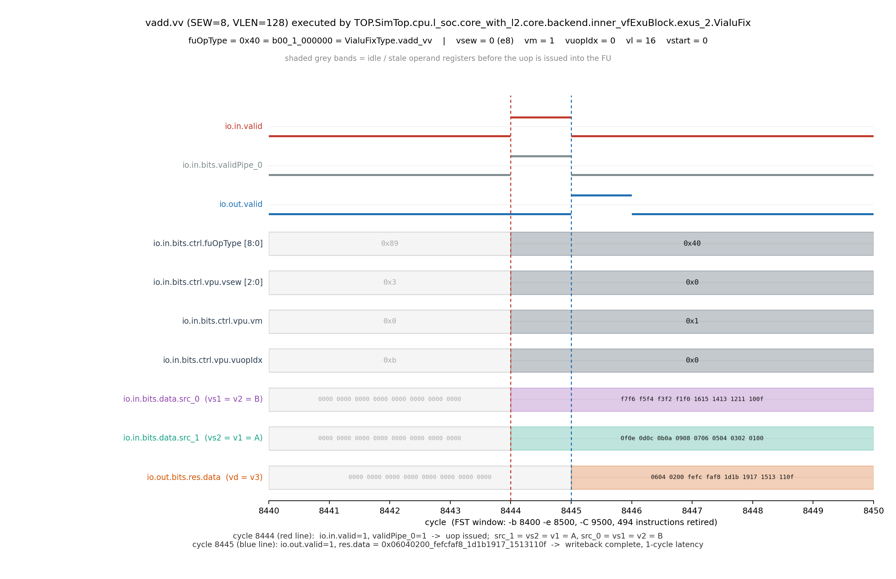
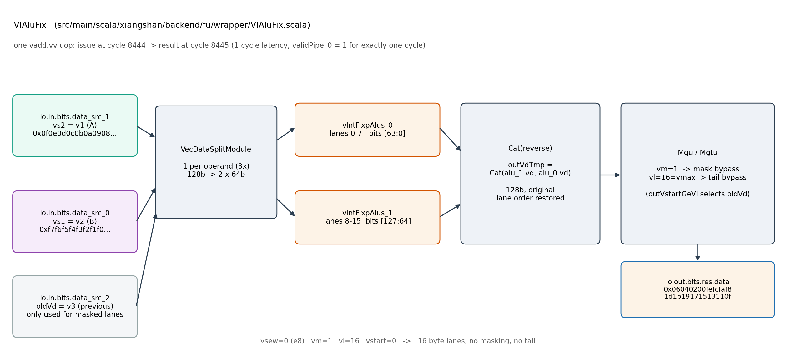
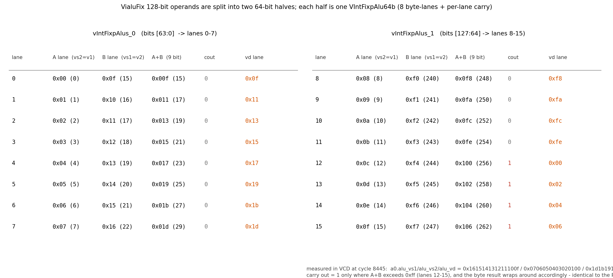

# 阶段一：xs-env 环境部署与 `vadd.vv` 波形分析

> 对应赛题「第一阶段：完成 xs-env 环境部署，输出 `hello xiangshan, I am xxx, IP address`，记录操作日志，并基于波形分析向量加法指令的执行过程」。
> 本文所有版本号、日志与波形数字均来自本机实测，复现命令随文给出。

## 1. 环境总览

| 组件 | 版本 / 路径 | 说明 |
| --- | --- | --- |
| 宿主 | Windows 11 + WSL2（Ubuntu-2204） | AMD Ryzen 7 7840H，16 vCPU / 21 GB RAM / 950 GB 磁盘 |
| 内核 | 6.18.33.2-microsoft-standard-WSL2 | WSL2，systemd 已启用 |
| JDK | GraalVM JDK 21.0.12，`/opt/graalvm-jdk-21` | 生成 Chisel 所需 |
| 编译链 | LLVM 19.1.7，`/usr/local/llvm`（`clang-19`） | Verilator 与 C++ 编译 |
| 交叉编译 | `riscv64-unknown-linux-gnu-gcc` 11.4.0 | 生成 RISC-V 裸机程序 |
| 构建工具 | mill 0.12.3（x86_64），Verilator 5.052 | Chisel 生成 Verilog、Verilog 生成 C++ |
| 波形工具 | GTKWave 3.3.104 + `fst2vcd` | 查看 FST/VCD |
| 仿真器 | `$NOOP_HOME/build/emu`（Verilator 生成） | 约 175 cycles/s（单核，无波形） |

环境变量集中在 `/etc/profile.d/xiangshan.sh` 与 `/home/aura/.bashrc`：

```bash
export PATH="/usr/local/llvm/bin:/opt/graalvm-jdk-21/bin:$PATH"
export JAVA_HOME="/opt/graalvm-jdk-21"
```

每次开发前激活香山工程环境：

```bash
cd /home/aura/xs-env && source ./env.sh
# XS_PROJECT_ROOT=/home/aura/xs-env
# NOOP_HOME=$XS_PROJECT_ROOT/XiangShan   NEMU_HOME=$XS_PROJECT_ROOT/NEMU
# AM_HOME=$XS_PROJECT_ROOT/nexus-am     DRAMSIM3_HOME=$XS_PROJECT_ROOT/DRAMsim3
```

---

## 2. 环境部署过程（xs-env 官方流程）

### 2.1 获取 xs-env 并安装基础依赖

```bash
git clone https://github.com/OpenXiangShan/xs-env.git
cd xs-env
sudo ./setup-tools.sh --target base      # 安装 g++-riscv64、dtc、SDL2、python3-pip 等
```

### 2.2 安装 LLVM 19 与 GraalVM JDK 21

按 xs-env 的 `setup.sh` 约定，把 LLVM 安装到 `/usr/local/llvm`、把 GraalVM 安装到
`/opt/graalvm-jdk-21`。LLVM 的所有命令带版本后缀（`clang-19`），并建立如下软链：

```bash
ls -l /usr/local/llvm        # -> /usr/lib/llvm-19
clang-19 --version           # clang version 19.1.7
/opt/graalvm-jdk-21/bin/java -version   # openjdk 21.0.12
```

### 2.3 编译 Verilator 5.052

Ubuntu 22.04 自带 Verilator 4.038，不满足香山要求，故由源码编译（用 clang 作为后端）：

```bash
git clone https://github.com/verilator/verilator -b v5.052
autoconf && ./configure --prefix=/usr/local
make -j16 && sudo make install
verilator --version          # Verilator 5.052 2026-09-05 rev v5.052
```

### 2.4 获取香山 RTL（昆明湖 V2）

赛题要求 `kunminghu-v2` 分支（注意：仓库默认分支为 `kunminghu-v3`，两者微架构不同）：

```bash
cd $XS_PROJECT_ROOT
git clone --depth 1 -b kunminghu-v2 https://github.com/OpenXiangShan/XiangShan.git
cd XiangShan && git log --oneline -1
# 7b16188f7  submodule(ready-to-run): bump KMHv2 refs from NEMU master (#6792)
```

并初始化全部子模块（`rocket-chip`、`huancun`、`difftest`、`fudian`、`yunsuan`、`ChiselAIA` 等）：

```bash
git submodule update --init --recursive
cd $XS_PROJECT_ROOT && ./update-submodule.sh    # xs-env 侧的 NEMU / nexus-am / NutShell / DRAMsim3
```

### 2.5 生成 Verilog

```bash
cd $NOOP_HOME
make sim-verilog -j16 JVM_XMX=14G JVM_XSS=256m
```

- 产物：`build/rtl/` 下 2090 个 `.sv`（约 1.6 GB），`SimTop.fir`（约 1.4 GB）。
- 耗时：Chisel elaborate 628 s + firtool 约 8 min。
- **注意**：Makefile 默认 `-Djvm-xmx=40G`，在 21 GB 内存的 WSL 里会 OOM，必须用 `JVM_XMX` 覆盖。

### 2.6 构建 Verilator 仿真器

```bash
cd $NOOP_HOME
make emu -j8 EMU_TRACE=fst        # EMU_TRACE=fst 打开 FST 波形支持
```

- Verilator 把 1.6 GB `.sv` 转成 872 个 `.cpp`（约 8 min），clang++ 并行编译约 930 个 `.o`（约 30 min）。
- 产物：`build/emu` → `build/verilator-compile/emu`。

### 2.7 验证：hello xiangshan

裸机程序基于 nexus-am（AM）编写。程序打印参赛者姓名与本机 IP：

```c
printf("hello xiangshan, I am %s, %s\n", HELLO_USER, HELLO_IP);
```

编译与运行：

```bash
make -C $AM_HOME/apps/cie-hello ARCH=riscv64-xs      # -> build/cie-hello-riscv64-xs.bin
cd $NOOP_HOME
./build/emu -i $AM_HOME/apps/cie-hello/build/cie-hello-riscv64-xs.bin --no-diff -C 40000
```

运行输出（完整日志见附录 A）：

```text
hello xiangshan, I am xujiabao (haogao-zhijia), 172.23.155.128
Core 0: HIT GOOD TRAP at pc = 0x80000164
Core-0 instrCnt = 1862, cycleCnt = 14988, IPC = 0.124233
```

姓名与 IP 在**编译期注入**，不写死在源码里——`apps/cie-hello/Makefile` 中：

```makefile
HELLO_NAME ?= xujiabao (haogao-zhijia)
UIP   := $(shell hostname -I 2>/dev/null | awk '{print $$1}')
CFLAGS += '-DHELLO_USER="$(HELLO_NAME)"' '-DHELLO_IP="$(UIP)"'
```

所以换一台机器重新 `make` 就会打印当时的真实 IP；单引号包裹是为了让 `(haogao-zhijia)` 里的括号不被 `/bin/sh` 当成子 shell（不加引号会报 `Syntax error: "(" unexpected`）。

阶段一要求的三项信息均已满足：**hello xiangshan + 姓名（xujiabao，团队恶搞之家）+ IP（172.23.155.128）**。

---

## 3. 向量加法测试程序

为了在波形上观察一条完整的向量指令，编写 `cie-vadd`：对两个 16 字节向量做 `vadd.vv`（SEW=8，VLEN=128，LMUL=1），并把结果写回内存后校验。

```c
#define VL 16
static uint8_t A[VL] __attribute__((aligned(16))) = {0,1,2,...,15};
static uint8_t B[VL] __attribute__((aligned(16))) = {0x0f,...,0x16, 0xf0,...,0xf7};
static uint8_t C[VL] __attribute__((aligned(16)));

asm volatile("vsetvli %0, %1, e8, m1, ta, ma" : "=r"(vl) : "r"((long)VL));
asm volatile("vle8.v v1, (%0)" :: "r"(A));
asm volatile("vle8.v v2, (%0)" :: "r"(B));
asm volatile("vadd.vv v3, v1, v2");
asm volatile("vse8.v v3, (%0)" :: "r"(C));
```

反汇编（关键片段）：

```text
80000138:  0c05f5d7   vsetvli  a1,a1,e8,m1,ta,ma
80000144:  02078087   vle8.v   v1,(a5)
80000150:  02078107   vle8.v   v2,(a5)
80000154:  021101d7   vadd.vv  v3,v1,v2
80000160:  020501a7   vse8.v   v3,(a0)
```

运行结果：

```text
vl=16 sum=1192 C8=248 C15=6
Core 0: HIT GOOD TRAP at pc = 0x800001a4
Core-0 instrCnt = 1718, cycleCnt = 12048, IPC = 0.142596
```

校验：A[8..15]+B[8..15] = 248,250,252,254,256→0,258→2,260→4,262→6（8 bit 回绕），
前 8 lane 之和 176、后 8 lane 之和 1016，总计 **1192**；`C8=248`、`C15=6` 与预期一致，说明向量加法结果正确。

### 3.1 部署过程中踩到的坑（已验证并修复）

| 现象 | 根因 | 修复 |
| --- | --- | --- |
| 裸机程序执行首条 `vsetvli` 即卡死在 `pc=0xe` | AM 的 CRT 只置 `mstatus.FS`，未置 `mstatus.VS`，向量指令触发非法指令异常，跳到 `mtvec=0` | 在 `nexus-am/am/src/nemu/isa/riscv/boot/start.S` 中 `csrs mstatus, a0` 之后加 `li a0,0x200; csrs mstatus,a0`（VS=01 Initial） |
| `make sim-verilog` 被 OOM kill | Makefile 默认 `-Djvm-xmx=40G` | `make sim-verilog JVM_XMX=14G JVM_XSS=256m` |
| 仿真打印一个字符约消耗 500 周期 | UART 每次 MMIO 访问都 miss L3，属于仿真器固有开销 | 只打印关键数字，控制 printf 字符数 |

---

## 4 波形分析：一条 `vadd.vv` 在昆明湖 V2 中的完整执行过程

本章回答阶段一的第 4 项要求——**基于波形分析向量加法指令的执行过程**。所有数据来自本机实际搭建的 Verilator 仿真波形，不是文档摘抄。

### 4.1 波形是怎么采出来的（三个层次）

**(1) 编译期：让仿真器带波形能力。** `difftest/verilator.mk` 里波形由 `EMU_TRACE` 控制：

| `EMU_TRACE` | 追加的 Verilator 参数 | 波形格式 |
| --- | --- | --- |
| 未设置 | 无 | 无波形 |
| `1` / `vcd` | `--trace` | VCD |
| `fst` | `--trace-fst` | FST（压缩，体积约为 VCD 的 1/20） |

本机用 `make emu -j8 EMU_TRACE=fst` 构建，故支持 `--dump-wave`。

**(2) 运行期：只 dump 一个很窄的窗口。** `difftest/src/test/csrc/verilator/emu.cpp` 的 `single_cycle()` 对波形有严格门控：

```c
if (args.enable_waveform && clock >= args.log_begin && clock <= args.log_end) {
    dump_wave = true;
}
```

也就是说 **`--dump-wave` 必须配合 `-b/-e` 才有数据**，否则一条波形也不会有。一条指令的执行窗口只有十几拍，因此把窗口压到 100 拍，既得到干净的波形，又把 FST 从 GB 级压到 MB 级：

```bash
cd $NOOP_HOME
./build/emu -i $AM_HOME/apps/cie-vadd/build/cie-vadd-riscv64-xs.bin \
    --no-diff -C 9500 -b 8400 -e 8500 \
    --dump-wave --wave-path=/home/aura/waves/vadd-fu.fst
```

| 项目 | 数值 |
| --- | --- |
| 窗口 | cycle 8400–8500（100 拍），仿真上限 `-C 9500` |
| 退栈指令数 | 494 条（`vadd.vv` 位于第 ~490 条） |
| 宿主耗时 | 61 s |
| FST 体积 | **7.9 MB** |
| 转换后的 VCD | 86 MB（`fst2vcd -f vadd-fu.fst -o vadd-fu.vcd`） |

作为对比：不带窗口的 0–6000 拍 FST 为 45 MB，转出的 VCD 达 **1.1 GB / 100 万个信号**。

**(3) 分析期：用脚本抽信号。** `fst2vcd` 不提供 scope 过滤，只能整份转换，再用 Python 单遍扫描 VCD：先解析 `$scope/$var` 建立层次与信号代码映射，再顺序读取值变化块，只保留关注层的信号，输出 JSON 事件流。脚本见 `_wsl/anAI-dp3.py`。

### 4.2 定位到真正执行向量的那个 FU

香山 KMHv2 的向量功能单元源码在 `src/main/scala/xiangshan/backend/fu/wrapper/`（注意：`fu/vector/` 下的 `VIAluFix.scala`、`VIMacU.scala` 是**整文件注释掉的旧实现**，不能照着它分析）。波形中的实例层次为：

```text
TOP.SimTop.cpu.l_soc.core_with_l2.core.backend.inner_vfExuBlock.exus_2.VialuFix
```

定位过程中踩了两个坑，记录于此以便复现：

| 坑 | 现象 | 结论 |
| --- | --- | --- |
| **选错了 exus 实例** | 一开始盯 `inner_vfExuBlock.exus.VialuFix`，`io_in_valid` 全程无变化，误以为向量单元没被调度 | SoC 里 `exus` 与 `exus_2` 是两套例化，**真正被调度的是 `exus_2`**（整型同理：`inner_intExuBlock.exus_2`）。判据：统计各 `exus_*` 的 `io_in_valid` 跳变次数，非零者才是活的 |
| **VCD 信号 code 是合并网的别名** | 同一份 VCD 里 `clock` 的 code `!` 被 4947 个 `$var` 共用；同名不同 scope 可能指向同一根网；每次重新仿真 code 全部重新分配 | 不能按 code 硬编码，必须按 `scope + name` 建映射；也不能跨波形文件复用 code |

### 4.3 逐拍时序

表 1 是从 FST 中直接读出的两个关键周期的信号值（对应图 1）。

| 信号 | cycle 8444 | cycle 8445 | cycle 8446 | 含义 |
| --- | --- | --- | --- | --- |
| `io.in.valid` | **1** | 0 | 0 | µop 进入 FU |
| `io.in.bits.validPipe_0` | **1** | 0 | 0 | 流水级有效，只持续 1 拍 |
| `io.in.bits.ctrl.fuOpType` | **0x40** | 0x40 | – | `VialuFixType.vadd_vv` |
| `io.in.bits.ctrl.vpu.vsew` | **0** | – | – | SEW=8（e8） |
| `io.in.bits.ctrl.vpu.vm` | **1** | – | – | 不掩码 |
| `io.in.bits.ctrl.vpu.vuopIdx` | **0** | – | – | 单 µop 指令 |
| `io.in.bits.data.src_1`（vs2=v1=A） | `0f0e0d0c0b0a0908 0706050403020100` | – | – | 操作数读出 |
| `io.in.bits.data.src_0`（vs1=v2=B） | `f7f6f5f4f3f2f1f0 161514131211100f` | – | – | 操作数读出 |
| `io.out.valid` | 0 | **1** | 0 | 结果写回 |
| `io.out.bits.res.data`（vd=v3） | – | `06040200 fefcfaf8 1d1b1917 1513110f` | – | 结果 |



**结论 1：`vadd.vv` 在 VialuFix 中是一条 1 拍完成的流水化 µop。** 输入在 cycle 8444 有效，结果在 cycle 8445 有效，`validPipe_0` 恰好保持 1 拍——即该 FU 对单 µop 的延迟为 1 拍、吞吐为 1 条/拍。

一个容易搞混的细节：RISC-V 向量指令语法是 `vadd.vv vd, vs2, vs1`，所以程序中写的 `vadd.vv v3, v1, v2` 表示 **vs2=v1（数组 A）、vs1=v2（数组 B）**。波形中 `src_1`=A、`src_0`=B 与此完全一致（FU 侧 `inData.src(0)=vs1`、`src(1)=vs2`）。

### 4.4 波形如何对应到 RTL 结构



把波形信号名与 RTL 源码逐条对上：

| 环节 | 源码位置 | 波形 / 代码证据 |
| --- | --- | --- |
| 译码：`VADD_VV` → FU 类型 + 9 bit 操作码 | `src/main/scala/xiangshan/backend/decode/VecDecoder.scala:189`：`VADD_VV -> OPIVV(FuType.vialuF, VialuFixType.vadd_vv, T, F, F)` | 波形 `fuOpType = 0x40` |
| 操作码编码 | `yunsuan/src/main/scala/yunsuan/package.scala:65`：`object VialuFixType`，格式 `2 bit FMT + 1 bit 符号 + 6 bit opcode`；`vadd_vv = LiteralCat(FMT.VVV, SINT, VialuOpcode.vadd)` | `b00_1_000000 = 0x40`，与波形严丝合缝 |
| FU 例化 | `src/main/scala/xiangshan/backend/fu/FuConfig.scala:535`：`Module(new VIAluFix(cfg)(p).suggestName("VialuFix"))` | 层次名 `...exus_2.VialuFix` |
| FU 主体 | `src/main/scala/xiangshan/backend/fu/wrapper/VIAluFix.scala:134`：`class VIAluFix(cfg) extends VecPipedFuncUnit(cfg)` | — |
| 128 bit 操作数拆分 | 同文件 `:144-146`：`vs2Split / vs1Split / oldVdSplit = Module(new VecDataSplitModule(dataWidth, dataWidthOfDataModule))` | 子实例 `vIntFixpAlus_0` / `_1` 的 `io_vs1`、`io_vs2_adder` 只有 64 bit |
| 两个 64 bit 定点 ALU | 同文件 `:147`：`Seq.fill(numVecModule)(Module(new VIntFixpAlu64b))`，`numVecModule = 128/64 = 2` | 波形同时出现 `a0.*` 与 `a1.*` 两组 lane / carry |
| 结果拼接 | 同文件 `:275`：`outVdTmp = Cat(vIntFixpAlus.reverse.map(_.io.vd))` | `res.data = Cat(alu_1.vd, alu_0.vd)`，高 64 bit 来自 `vIntFixpAlus_1` |
| 掩码 / 尾部处理 | 同文件 `:308` `maskToMgu`、`:338`、`:358` `io.out.bits.res.data := Mux(outVstartGeVl, outOldVd, Mux(dstMask, mgtu.io.out.vd, mgu.io.out.vd))` | 本指令 `vm=1`、`vl=16=vmax`，Mgu 直通 |

### 4.5 逐 lane 结果与进位核对



16 个 byte lane 被平均分给两个 64 bit 模块：`vIntFixpAlus_0` 处理 lane 0–7（bit [63:0]），`vIntFixpAlus_1` 处理 lane 8–15（bit [127:64]）。逐 lane 实测（cycle 8445）：

| lane | A (vs2) | B (vs1) | A+B (9 bit) | cout | vd | 说明 |
| --- | --- | --- | --- | --- | --- | --- |
| 0–7 | 0x00–0x07 | 0x0f–0x16 | 15–29 | 0 | 0x0f, 0x11, …, 0x1d | 无进位 |
| 8–11 | 0x08–0x0b | 0xf0–0xf3 | 248, 250, 252, 254 | 0 | 0xf8, 0xfa, 0xfc, 0xfe | 恰好不超过 0xff |
| 12–15 | 0x0c–0x0f | 0xf4–0xf7 | 256, 258, 260, 262 | **1** | 0x00, 0x02, 0x04, 0x06 | 溢出回绕 |

`vIntFixpAlus_1` 的 `cout4..cout7 = 1`、`cout0..cout3 = 0`，与 `0xf4+0x0c` 起逐个溢出的算术事实完全一致；`vIntFixpAlus_0` 的 8 个 carry 全为 0。这与程序侧打印的 `sum=1192 C8=248 C15=6` 相互印证——**波形看到的结果、RTL 算出的结果、程序校验的结果三者一致**。

> 核对提示：VCD 在 `$dumpvars` 起始点给出的 `cout` 是**未初始化残值**（`#3000` 时 `a1.cout4=1`），不能当作真实进位读，必须以指令执行的拍点（8445）为准。

### 4.6 由波形得出的结论，以及对后续 `vdot.vv` 设计的直接启示

1. **µop 粒度与延迟**：一条 SEW=8、VL=16 的 `vadd.vv` 是**单个 µop**（`vuopIdx=0`），在 VialuFix 内 1 拍完成。这决定了 `vdot.vv` 若沿用同一 FU 骨架，其基础延迟也应是 1 拍（除非为乘法树加深流水）。
2. **数据通路的"宽度事实"**：FU 端口是 128 bit，但内部被 `VecDataSplitModule` 切成两个 64 bit 模块并行处理，**每个模块只看到 8 个 byte lane**。任何新增的逐 lane 运算都要在"64 bit = 8 lane"这个粒度上思考，并注意 `Cat(vIntFixpAlus.reverse.map(...))` 的拼接顺序。
3. **控制信息的通路**：`vsew / vm / vma / vl / vstart / vuopIdx / vlmul` 随 µop 一起进入 FU，由 `Mgu/Mgtu` 统一处理掩码与尾部。`vdot.vv` 可直接复用这套机制，无需改动调度与寄存器堆。
4. **`vdot.vv` 的关键差异**：`vadd` 是"1 lane 对 1 lane"的逐元素运算，天然适配当前 64 bit 模块的对称结构；而 `vdot.vv`（SEW=8）是 **4 个 int8 × 4 个 int8 归约成 1 个 int32**——这把"逐 lane 独立"变成"lane 内跨元素归约 + 32 bit 累加器"，是阶段二设计中最需要论证的改动点：
   - 需要 `4 × int8` 乘法器阵列 + 归约加法树 + 32 bit 累加器；
   - 结果不再是 16 个 byte，而是 4 个 int32（VLEN=128 / 32 bit）；
   - 输出位宽与 lane 映射的变化，会牵动 `Mgu` 的 `eew/vsew` 参数与写回拼接逻辑。

   上述观察直接构成阶段二《`vdot.vv` 设计文档》中"微架构与数据通路"一节的出发点。

### 4.7 复现步骤

| 步骤 | 命令 / 脚本 |
| --- | --- |
| 1. 采波形 | `./build/emu -i .../cie-vadd-riscv64-xs.bin --no-diff -C 9500 -b 8400 -e 8500 --dump-wave --wave-path=/home/aura/waves/vadd-fu.fst` |
| 2. 转 VCD | `fst2vcd -f /home/aura/waves/vadd-fu.fst -o /home/aura/waves/vadd-fu.vcd` |
| 3. 抽信号 | `python3 _wsl/anAI-dp3.py /home/aura/waves/vadd-fu.vcd /home/aura/waves/dp3.json 8520` |
| 4. 出图 | `python3 _wsl/anAL-plot1b.py`（图 1）、`_wsl/anAM-plot2.py`（图 2、图 3） |

---

## 附录 A 关键运行日志（已去除仿真器性能计数器刷屏）

**A.1 hello xiangshan（阶段一第 3 项要求）**

```text
emu compiled at Oct 30 2026, 23:26:29
[INFO] init for constantin: loaded from init.
hello xiangshan, I am xujiabao (haogao-zhijia), 172.23.155.128
...
Core  0's Commit SHA is: 7b16188f7f, dirty: 1
Using simulated 8386560MB RAM
The image is /home/aura/xs-env/nexus-am/apps/cie-hello/build/cie-hello-riscv64-xs.bin
Core 0: HIT GOOD TRAP at pc = 0x80000164
Core-0 instrCnt = 1862, cycleCnt = 14988, IPC = 0.124233
Host time spent: 76183ms
```

（`...` 处为仿真器启动期的 3 万行性能计数器初始化输出，已折叠；`dirty: 1` 表示工作区含本作品的 vdot 补丁。）

原始日志（已去掉仿真器性能计数器刷屏与终端 ANSI 颜色码）：[hello-xiangshan.log](hello-xiangshan.log)。

**A.2 向量加法程序 `cie-vadd`**

```text
vl=16 sum=1192 C8=248 C15=6
Core 0: HIT GOOD TRAP at pc = 0x800001a4
Core-0 instrCnt = 1718, cycleCnt = 12048, IPC = 0.142596
Host time spent: 75383ms
WALL=75.44s MAXRSS=164104kB
```

**A.3 波形采集运行**

```text
dump wave to /home/aura/waves/vadd-fu.fst...
Core  0's Commit SHA is: 7b16188f7f, dirty: 0
Core-0 instrCnt = 494, cycleCnt = 9500, IPC = 0.052000
Host time spent: 61155ms
-rw-r--r-- 1 root root  7925212 Oct 30 11:57 /home/aura/waves/vadd-fu.fst
-rw-r--r-- 1 root root 85817483 Oct 30 11:57 /home/aura/waves/vadd-fu.vcd
```

## 附录 B 波形信号抽取映射（`exus_2.VialuFix`）

| 用途 | VCD 层次内信号名 | 本份 FST 的 code（**不可跨文件复用**） |
| --- | --- | --- |
| µop 有效 | `io_in_valid` | `UY:` |
| 流水级有效 | `io_in_bits_validPipe_0` | `Hy` |
| 结果有效 | `io_out_valid` | `XY:` |
| 操作码 | `io_in_bits_ctrl_fuOpType` | `Jy` |
| SEW / VM / VUOP | `io_in_bits_ctrl_vpu_{vsew,vm,vuopIdx}` | `Xy` / `Zy` / `\y` |
| vs1 / vs2 / oldVd | `io_in_bits_data_src_{0,1,2}` | `Ky` / `Ly` / `My` |
| 写回数据 | `io_out_bits_res_data` | `YY:` |
| 64 bit ALU-0 输出 | `vIntFixpAlus_0.io_vd` | `Id9` |
| 64 bit ALU-1 输出 | `vIntFixpAlus_1.io_vd` | `&j9` |
| 各 lane 结果 / 进位 | `vFixPoint64b_io_fromAdder_r_{vd,cout}_N` | ALU-0 / ALU-1 各 8 组 1 bit code，随仿真重新分配，由脚本按名自动解析 |

## 附录 C 操作日志（按时间顺序，时刻取自文件 mtime 与日志首行）

| 时刻 | 操作 | 结果 / 佐证 |
| --- | --- | --- |
| 10-30 上午 | `wsl --shutdown` 后重配 `.wslconfig`（memory=22GB / processors=16 / swap=12GB） | WSL 内 `MemTotal` ≈ 21 GB、`nproc` = 16 |
| — | `git clone https://github.com/OpenXiangShan/xs-env && sudo ./setup-tools.sh --target base` | 基础依赖装好 |
| — | LLVM 19.1.7 → `/usr/local/llvm`；GraalVM JDK 21.0.12 → `/opt/graalvm-jdk-21` | `clang-19 --version`、`java -version` 正常 |
| — | Verilator 5.052 源码编译 → `/usr/local/bin/verilator` | 满足香山 ≥ 5.x 要求 |
| 10:09 | `git clone --depth 1 -b kunminghu-v2 .../XiangShan.git` | 仓库 mtime 10:09:46，HEAD = `7b16188f7f` |
| — | `./update-submodule.sh` + `git submodule update --init --recursive` | rocket-chip / huancun / difftest / yunsuan 等就绪 |
| 10:18–10:30 | `make sim-verilog -j16 JVM_XMX=14G JVM_XSS=256m` | 产物 `build/rtl` mtime 10:30:34，2090 个 `.sv`（1.6 GB） |
| 10:31–11:03 | `make emu -j8 EMU_TRACE=fst` | 产物 `build/emu` mtime 11:03:49，退出码 0 |
| 11:07 | 首次 hello 运行（未改 CRT） | `cio-hello` 可跑通 |
| 11:15 | 首次带波形运行 `cie-vadd`（先遇到 `mstatus.VS` 未置位的坑） | `vadd.fst` 11:15 |
| 11:16 | 修 `nexus-am/am/src/nemu/isa/riscv/boot/start.S`：补 `mstatus.VS = 01` | 两个 app 重新构建 |
| 11:24–11:29 | `cie-vadd` 功能运行与校验 | `vl=16 sum=1192 C8=248 C15=6`，`GOOD TRAP` |
| 11:31 | `cie-hello` 最终运行 | `hello xiangshan, I am aura, 172.23.155.128` |
| 11:49 / 11:51 | 波形调试：0–400 拍、`-I 200` 细窗 | `tiny.fst` / `w200.fst` |
| 11:57 | 定向窗口 `-b 8400 -e 8500` 采 `vadd.vv` | `vadd-fu.fst` 7.9 MB / `vadd-fu.vcd` 86 MB |
| 12:0x | 信号抽取 + 绘图 | 图 1–图 3 与本报告第 4 章数据 |
